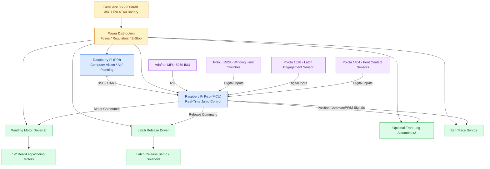

# Halo Bunny — Electrical Architecture

## System Overview

The Halo Bunny robot uses a Raspberry Pi for computer vision
and high-level processing, while a microcontroller handles
real-time motor control, sensor feedback, and jumping.

## Electrical Architecture

## System Components

| Subsystem | Component | Purpose |
|---|---|---|
| Computing | Raspberry Pi | Computer vision, AI, high-level planning |
| Control | Microcontroller | Real-time motor and sensor control |
| Power | 3S LiPo Battery | Main power source |
| Power | Regulators / Fuses / E-Stop | Power distribution and electrical protection |
| Jumping | Winding Motor | Compresses springs to store energy |
| Jumping | Motor Driver | Controls winding motor |
| Jumping | Latch Actuator | Releases stored spring energy |
| Movement | Front-Leg Actuators | Optional landing and posture control |
| Expression | Ear / Face Servos | Animatronic movement |
| Sensors | IMU | Detects acceleration and rotation |
| Sensors | Limit Switches | Detect winding limits |
| Sensors | Latch Sensor | Confirms latch engagement |
| Sensors | Foot Sensors | Detects ground contact |

## Control Sequence

1. **Idle:** Check sensors and safety conditions.
2. **Wind:** Activate winding motors to compress springs.
3. **Latch:** Confirm the mechanical latch is engaged.
4. **Ready:** Wait for an authorized jump command.
5. **Release:** Activate latch release actuator.
6. **Flight:** Monitor orientation using the IMU.
7. **Landing:** Detect foot contact.
8. **Recovery:** Reset for the next jump.

## Important Design Notes

- Raspberry Pi handles high-level computing.
- Microcontroller handles real-time control.
- Motor drivers supply actuator current.
- Voltage regulators provide appropriate supply voltages.
- Sensors send feedback to the microcontroller.
- The mechanical latch must remain secure if electrical power is lost.
- An emergency stop removes actuator power but does not remove stored spring energy.

**Note:** This is a functional block diagram, not a complete
electrical wiring schematic. Actual voltage rails, current
ratings, fuses, grounding, and hardware safety interlocks
must be specified before construction.