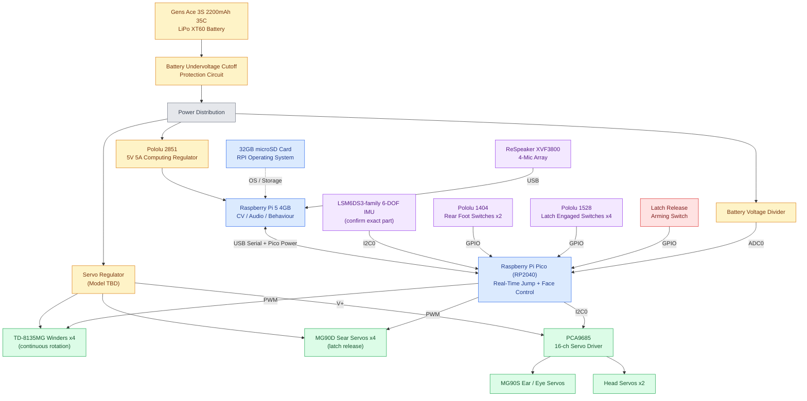

# Halo Bunny — Electrical Architecture

## System Overview

The Halo Bunny robot uses a Raspberry Pi for computer vision, audio
and high-level behaviour, while a Raspberry Pi Pico (RP2040) handles real-time
jump control: winding, latching, releasing, and the face servos.

Each of the four legs is wind-and-latch: a winder servo pulls the leg in
against its spring until a latch catches (confirmed by a latch switch), and
a small sear servo trips the latch to release the jump.

## Electrical Architecture

## System Components

| Subsystem | Component | Purpose |
|---|---|---|
| Computing | Raspberry Pi 5 | Computer vision, audio, behaviour, high-level commands |
| Control | Raspberry Pi Pico (RP2040) | Real-time winding, latching, release, face servos |
| Power | 3S LiPo Battery | Main power source |
| Power | Regulators / Fuses / E-Stop | Power distribution and electrical protection |
| Power | Battery Voltage Divider | Lets the Pico measure battery voltage (ADC0) |
| Jumping | TD-8135MG Winders x4 | Wind each leg's spring until it latches |
| Jumping | MG90D Sears x4 | Trip each leg's latch to release the spring |
| Expression | PCA9685 + MG90S servos | Ears and eyes |
| Expression | PCA9685 + head servos x2 | Head pan / tilt |
| Sensors | IMU | Attitude, liftoff and touchdown detection |
| Sensors | Latch Switches x4 | Confirm each leg is wound and latched |
| Sensors | Foot Switches x2 | Rear-foot ground contact |
| Sensors | ReSpeaker XVF3800 | Voice direction and audio (to the Pi) |
| Safety | Arming Switch | Firmware refuses to release unless armed |

## Pico Pin Map

Source of truth: `rabbit-firmware/include/rabbit-firmware.hpp`.

| Function | Pins |
|---|---|
| Sears (RL, RR, FL, FR) | GP2, GP4, GP6, GP10 (each on its own PWM slice) |
| Latch switches (RL, RR, FL, FR) | GP3, GP5, GP7, GP11 |
| I2C0 SDA / SCL (IMU, PCA9685 @ 0x40) | GP8 / GP9 |
| Winders (RL, RR, FL, FR) | GP12, GP13, GP14, GP15 |
| Foot switches (RL, RR) | GP16, GP17 |
| Arming switch | GP18 |
| Battery voltage (ADC0) | GP26 |
| Free | GP0–1 (UART0 debug), GP19–22, GP27–28 |

## Control Sequence

1. **Idle:** Check sensors, battery and the arming switch.
2. **Wind:** Run each winder until its latch switch closes, then stop it.
3. **Ready:** All four latch switches closed; wait for a jump command from the Pi.
4. **Release:** If armed, trip the four sears (rear left/right offset sets the turn).
5. **Flight:** Hold the head still; track attitude with the IMU.
6. **Landing:** Detect touchdown from the foot switches or an IMU acceleration spike.
7. **Recovery:** Settle, then wind again for the next hop.

## Important Design Notes

- Raspberry Pi handles vision, audio and behaviour; the Pico handles real-time control.
- Every sear needs its own PWM slice: releasing restarts the slice's counter, which would glitch any other servo on it.
- Servo current: four winders stalling at once can draw well over 5 A. Size the servo regulator for it, or wind the legs one or two at a time.
- The face and head servos share the servo rail; rate-limit their moves so they don't stall together.
- All grounds (battery, both regulators, Pi, Pico, servos) must be common.
- The mechanical latch must remain secure if electrical power is lost.
- An emergency stop removes actuator power but does not remove stored spring energy.
- Front-leg hip actuators are not currently planned.

**Note:** This is a functional block diagram, not a complete
electrical wiring schematic. Actual voltage rails, current
ratings, fuses, grounding, and hardware safety interlocks
must be specified before construction.
